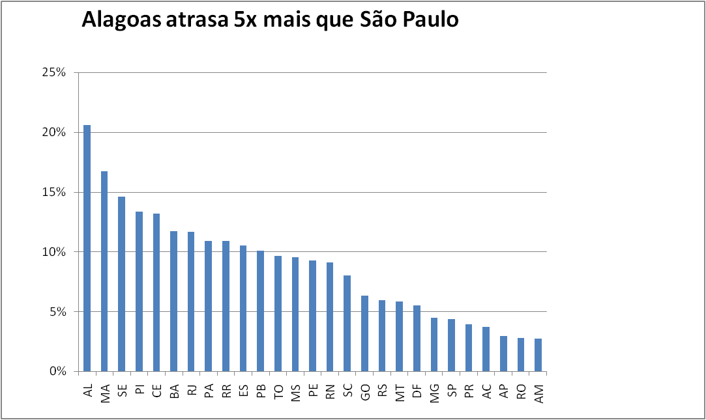

# Análise de atrasos nas entregas de e-commerce

Análise de **99.441 pedidos reais** da Olist, um marketplace brasileiro (2016 a 2018), feita no **Excel**, para descobrir quantas entregas atrasam e em quais estados.

## Principais descobertas

- **6,8% das entregas atrasaram** (calculado só sobre os pedidos entregues, porque os cancelados não podiam atrasar).
- **O Nordeste concentra os piores prazos.** Alagoas lidera, com **20,6%** de atrasos, seguida de Maranhão (16,7%) e Sergipe (14,6%).
- **São Paulo atrasa só 4,4%.** Alagoas atrasa quase **5 vezes mais** que SP.
- **Hipótese:** a maioria dos vendedores fica no Sudeste, então a distância aumenta o atraso no Nordeste. Uma solução seria um centro de distribuição na região ou prazos de entrega maiores para esses estados.

## O que foi feito

1. **Importação** de 2 tabelas (pedidos e clientes) a partir de arquivos CSV.
2. **Coluna de dias antes do prazo**: data prometida menos data de entrega.
3. **Classificação de cada pedido** com SE aninhado: no prazo, atrasou ou não entregue (tratando os pedidos sem data de entrega).
4. **PROCV** para trazer o estado do cliente da tabela de clientes.
5. **Tabelas dinâmicas** para o resumo geral e a % de atraso por estado.
6. **Gráfico de colunas** ordenado, com título que mostra a conclusão.

## Arquivos

- `entregas_olist.xlsx`: a planilha completa, com as abas pedidos, clientes, resumo, estados e grafico.
- `grafico_estado.png`: o gráfico de atrasos por estado.

## Ferramentas

Excel · PROCV · SE · Tabela dinâmica · Gráficos

## Dados

[Brazilian E-Commerce Public Dataset by Olist](https://www.kaggle.com/datasets/olistbr/brazilian-ecommerce), no Kaggle.

## Autor

Mateus Kauã Ferreira Corrêa · [LinkedIn](https://www.linkedin.com/in/mateuskferreira)
